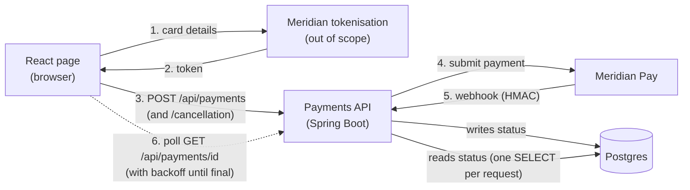
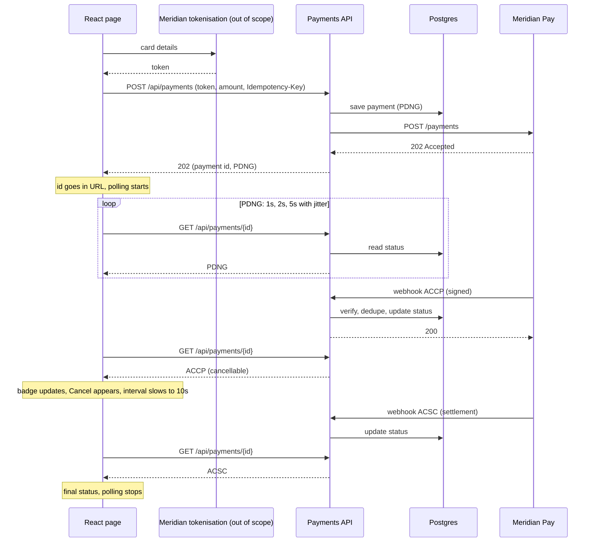
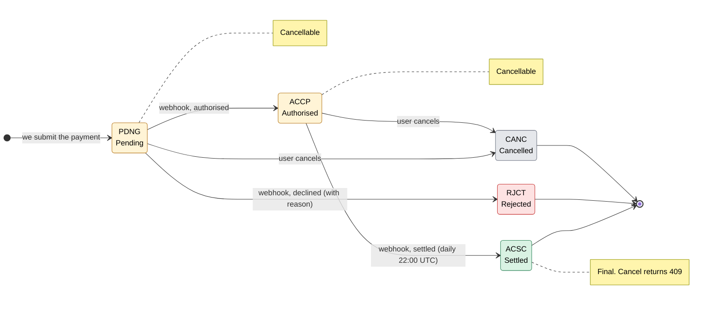
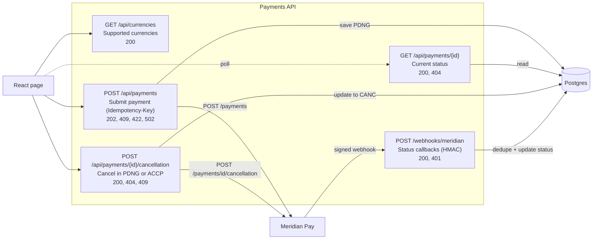

# Payments App: Spec v0.1

## 1. Goal and scope

A Spring Boot service (the Payments API, part of the Payments App) between a merchant web page and Meridian Pay. It must:

1. **Submit** a card payment using a token (the service never sees card details)
2. **Track status** as Meridian reports back via webhook
3. **Cancel** a payment while it is still cancellable
4. Work with **multiple currencies**

Plus a minimal React page, a Postgres database, and a Meridian mock.

**Out of scope (v1):** refunds, reconciliation job, database migration tool, auth on our own API, FX conversion, zero/three-decimal currencies (see 6.4), settlement reports.

---

## 2. Run it from GitHub

```bash
git clone https://github.com/spriyabs/payments-app.git
cd payments-app
cp .env.example .env          # safe defaults, no real secrets
docker compose up --build
```

| URL | What |
|-----|------|
| http://localhost:3000 | React UI |
| http://localhost:8080/actuator/health | Payments API health (the API contract is `docs/openapi.yaml`) |
| http://localhost:9090 | Meridian mock (payments, cancel, signed webhooks) |
| localhost:5432 | Postgres (`payments` db) |

**Compose services:** `postgres` (healthcheck, named volume), `meridian-mock`, `payments-api` (waits for DB health), `payment-ui` (nginx).

**No ngrok needed locally:** the mock calls back `http://payments-api:8080/webhooks/meridian` over the Docker network.

**Dev without Docker for the app:** `docker compose up postgres meridian-mock`, then `mvn spring-boot:run` and `npm run dev`.

**Real sandbox instead of the mock:** set `MERIDIAN_BASE_URL`, `MERIDIAN_API_KEY`, `MERIDIAN_WEBHOOK_SECRET` and a public `CALLBACK_URL` (e.g. via ngrok) in `.env`.

**Repo hygiene:** `.env` is gitignored, only `.env.example` is committed.

---

## 3. Architecture



The dotted line is the only polling: the browser repeatedly calls our API. Inside the backend, each API request does a normal database read. Meridian pushes only to the webhook endpoint, so React never receives a push.

### Status flow end to end



**Key decision:** card data goes browser → Meridian only. Our backend handles only `token`.

---

## 4. Payment state machine (mirrors Meridian)



Yellow states are still open (and cancellable). Green, red and grey are final: no further transitions are accepted.

| From | To | Trigger |
|------|----|---------|
| PDNG | ACCP, RJCT, CANC | webhook / cancel |
| ACCP | ACSC, CANC | webhook / cancel |
| ACSC, RJCT, CANC | none | final |

Invalid transitions are **stored, logged and ignored** (still `200` to Meridian). A late `ACCP` arriving after we cancelled must never revert `CANC`.

---

## 5. Our API

The contract lives in [`openapi.yaml`](openapi.yaml) and is the **source of truth**. Controllers and DTOs are currently hand-written to match it (no code generation yet), and the integration tests exercise the documented status codes and error codes. Switching to generated interfaces (openapi-generator, `interfaceOnly`) later would stop the code drifting from the spec.

These are **our** endpoints, served by the Payments API.

**The `token` is Meridian's tokenised card details.** Meridian tokenises the card and issues a single-use token that stands in for the card data. Our API only ever receives that token. The real card details stay with Meridian and never reach this service. **Tokenisation itself (Meridian's `/tokens`) is out of scope for this version:** we neither call nor test it, and the mock does not implement it.

| Method | Path | Called by | Purpose |
|--------|------|-----------|---------|
| GET | `/api/currencies` | Client | Supported currencies |
| POST | `/api/payments` | Client | Submit a payment (requires `Idempotency-Key`) |
| GET | `/api/payments/{id}` | Client | Current status, read from our DB |
| POST | `/api/payments/{id}/cancellation` | Client | Cancel in `PDNG` or `ACCP` |
| POST | `/webhooks/meridian` | Meridian | Status callbacks (HMAC-signed) |



Dotted line: polled repeatedly by the UI. Arrows into Meridian are our server-to-server calls; the arrow from Meridian is its webhook.

### 5.1 Error codes and meanings

Every error is an RFC 7807 problem response (`application/problem+json`) with a stable, machine-readable `code`:

```json
{
  "title": "Unprocessable Entity",
  "status": 422,
  "code": "CURRENCY_NOT_SUPPORTED",
  "detail": "Currency JPY is not supported"
}
```

In `openapi.yaml`, each error is a reusable response (`components/responses`) and the endpoints link to it with `$ref`. The codes are the `ErrorCode` schema, and the `x-error-reference` block at the end of the file documents them.

| Code | HTTP | Meaning | Returned by |
|------|------|---------|-------------|
| `VALIDATION_ERROR` | 400 | Malformed JSON, missing `Idempotency-Key`, or a field failed validation (for example the amount is not in the form `125.50`). | submit |
| `INVALID_SIGNATURE` | 401 | Webhook signature missing or invalid. No state is changed. | webhook |
| `PAYMENT_NOT_FOUND` | 404 | No payment with that id. | get payment, cancel |
| `IDEMPOTENCY_KEY_CONFLICT` | 409 | The `Idempotency-Key` was already used with a different request body. | submit |
| `PAYMENT_NOT_CANCELLABLE` | 409 | The payment is settled (`ACSC`) or rejected (`RJCT`). The body includes the current `payment`, so the UI can refresh its badge. | cancel |
| `INVALID_AMOUNT` | 422 | The amount is zero, or above `MAX_PAYMENT_AMOUNT`. | submit |
| `CURRENCY_NOT_SUPPORTED` | 422 | The currency is not on the allowlist, or has 0 or 3 decimal places (not supported in v1). | submit |
| `PROVIDER_REJECTED` | 422 | Meridian rejected the request, for example the token is expired or already used. | submit |
| `PROVIDER_UNAVAILABLE` | 502 | Meridian unavailable after retries. **Submit:** the payment stays `PDNG`; repeating the same request is safe. **Cancel:** state is unchanged; retry later. | submit, cancel |
| `INTERNAL_ERROR` | 500 | Unexpected server error. On the webhook it is returned only for genuine processing failures (for example the database is down), so that Meridian retries. | any |

Success codes: `200` (success; also a repeated cancel, and webhooks that are duplicates, stale or for unknown payments, so Meridian stops retrying) and `202` (payment accepted; poll `GET /api/payments/{id}` for the result).

**Decline reasons** (`statusReason` when status is `RJCT`)

| Code | Meaning | Message shown to the user |
|------|---------|---------------------------|
| `AM04` | Insufficient funds | Insufficient funds |
| `AC04` | Card closed or blocked | Card is closed or blocked |
| `FF01` | Invalid card data | Card details are invalid |
| `NARR` | Other reason; see the provider logs | Payment could not be completed |

Raw provider errors and details are never shown to the user.

---

## 6. Behaviour rules

### 6.1 Submit payment
1. Validate body, `Idempotency-Key`, currency (6.4) and amount.
2. **Idempotency:** same key + same normalised body hash → return the existing payment; different body → `409`. If the existing payment is `PDNG` with **no** `providerPaymentId` (an earlier attempt never reached Meridian), go to step 5 and resubmit.
3. Generate `id` (UUID) and `endToEndId` (32-char UUID without dashes).
4. **Persist first** as `PDNG`, **then** call Meridian (avoids the webhook-before-response race).
5. Call Meridian `POST /payments` with `Idempotency-Key = payment id`.
6. `202` → store `providerPaymentId`. `422` → mark `RJCT/NARR`, return `422`.
7. Timeout or 5xx → retry 3x with the **same** key. If still failing, return `502` and leave the payment `PDNG` without a `providerPaymentId`. The caller can repeat the same request (step 2 resubmits with the same provider key, so it is safe even if Meridian had processed the first attempt). Tokens are single-use and can expire; if Meridian returns `422`, the payment becomes `RJCT/NARR`.

### 6.2 Webhook
1. HMAC-SHA256 over the **raw body bytes**, constant-time compare with `X-Meridian-Signature`. Mismatch → `401`.
2. Find the payment by `endToEndId`.
3. One transaction: insert `eventId` into `webhook_event` (unique). Conflict → duplicate → `200`, no-op.
4. Apply the state machine. Invalid transition → log and ignore.
5. Unknown `endToEndId` → `200` + warn log.

Meridian retries failed deliveries for up to 24 hours, so return a non-2xx only for genuine processing errors (e.g. DB down), never for duplicates or stale events.

### 6.3 Cancel
1. Already `CANC` → `200`. Locally `ACSC` or `RJCT` → `409 PAYMENT_NOT_CANCELLABLE` (body includes the current payment).
2. Otherwise call Meridian cancellation with key `cancel-{id}`.
3. `200` → `CANC`. Meridian `409` → fetch the payment from Meridian, update local state, return `409 PAYMENT_NOT_CANCELLABLE` with the refreshed payment.
   If the refreshed status is `CANC` (an earlier cancel reached Meridian but its answer was lost), return `200` instead.
4. Meridian timeout or 5xx → return `502 PROVIDER_UNAVAILABLE` and leave local state unchanged (the caller can safely retry; the cancel key `cancel-{id}` is stable).
5. Payment still `PDNG` with no `providerPaymentId` (the submit never got a confirmed answer) → `502 PROVIDER_UNAVAILABLE`, nothing is sent. Meridian cancels by its own payment id, and cancelling locally could leave a live authorisation at Meridian. The caller repeats the original submit (which resubmits safely), then cancels.
6. Any other Meridian `4xx` (for example `404` unknown payment) → `422 PROVIDER_REJECTED`, state unchanged.

### 6.4 Multi-currency
- **Allowlist** via `SUPPORTED_CURRENCIES` (default: GBP, EUR, USD, CAD, AUD, CHF, SEK, NOK, DKK, PLN).
- Money is stored as **minor units (`BIGINT`) + currency**, never `double`. Conversion uses `java.util.Currency#getDefaultFractionDigits()`. Parse with `BigDecimal` + `movePointRight` + `longValueExact()` so bad input throws instead of rounding.
- Wire format is a string with exactly the currency's decimal places (`"125.50"`).
- **Meridian's schema forces exactly 2 decimals**, so v1 accepts only 2-decimal currencies. JPY (0) and KWD/BHD (3) are rejected with `422` and a clear message. The restriction lives in one place (the Meridian mapper) to lift later.
- No FX. `MAX_PAYMENT_AMOUNT` is configurable. `GET /api/currencies` feeds the UI dropdown.

---

## 7. Data (Postgres 16, Hibernate)

Target shape (the entities must produce this):

```sql
payment(
  id UUID PK, end_to_end_id VARCHAR(35) UNIQUE NOT NULL,
  provider_payment_id TEXT NULL,
  idempotency_key VARCHAR(64) UNIQUE NOT NULL, request_hash CHAR(64) NOT NULL,
  amount_minor BIGINT NOT NULL CHECK (amount_minor > 0),
  currency CHAR(3) NOT NULL,
  status VARCHAR(4) NOT NULL, status_reason VARCHAR(4),
  created_at TIMESTAMPTZ, updated_at TIMESTAMPTZ, version BIGINT
)

webhook_event(
  event_id TEXT PK, payment_id UUID FK, status VARCHAR(4),
  occurred_at TIMESTAMPTZ, received_at TIMESTAMPTZ
)
```

- **Hibernate owns the schema**, generated from the JPA entities (no migration tool).
- Config: `spring.jpa.hibernate.ddl-auto: update` for the app, so data survives restarts in the compose volume. Tests use `create-drop`.
- Declare constraints on the entities, because Hibernate will not invent them: `@Column(unique = true, nullable = false)`, `@Table(indexes = ...)`, `@Check(constraints = "amount_minor > 0")`, and `@Version` for optimistic locking.
- **Limitation:** `update` only adds tables and columns. It never drops, renames or changes column types, so any non-additive change needs manual SQL. Fine for this scope; revisit (Flyway or Liquibase) before real production use.
- Tests run on **Testcontainers Postgres**, so there are no H2 dialect surprises.

---

## 8. Meridian mock (`meridian-mock/`)

Implements the relevant parts of the provided Meridian spec so everything runs offline.

| Feature | Behaviour |
|---------|-----------|
| `/payments` | Needs `X-Api-Key`. Returns `202 PDNG`, honours `Idempotency-Key` (same body replays the same payment, different body `409`). A token not shaped like `tok_...`, or already used, is `422 INVALID_TOKEN`. There is no `/tokens` endpoint (out of scope); the mock accepts any new `tok_...` value. |
| Callbacks | Body signed with HMAC-SHA256 (lowercase hex) in `X-Meridian-Signature`, sent to the request's `callbackUrl`. Failed deliveries are retried every 5s, up to 10 attempts. |
| Cancel | `POST /payments/{id}/cancellation` with an `Idempotency-Key`. Valid in PDNG and ACCP, `409` otherwise. Replaying the same key returns the same result. A pending authorisation never overrides a cancel. |
| Settlement | ACCP → ACSC after `MOCK_SETTLE_AFTER_SECONDS` (default 30). Also `POST /mock/payments/{id}/settle` to force it. |
| Chaos switches | `MOCK_DUPLICATE_WEBHOOKS=true` (every callback sent twice with the same `eventId`), `MOCK_OUT_OF_ORDER=true` (random delivery delays), `MOCK_AUTH_DELAY_MS` |
| Tests | `cd meridian-mock && npm test` (Node built-in runner, no dependencies, no Docker) |

The mock is for development and tests only. It posts callbacks to whatever `callbackUrl` it is given, so never expose it publicly.

**Magic test tokens (mock only).** The outcome comes from the token's prefix; add a unique suffix to each token (tokens are single-use), for example `tok_decline_funds_1`.

| Token prefix | Outcome |
|--------------|---------|
| any other `tok_...` | ACCP, then settles |
| `tok_decline_funds` | RJCT / AM04 |
| `tok_decline_blocked` | RJCT / AC04 |
| `tok_decline_invalid` | RJCT / FF01 |
| `tok_decline_other` | RJCT / NARR |
| `tok_slow` | ACCP after a 3 minute callback delay |

---

## 9. React page

Single page (React, bundled with webpack):

1. **Form:** token (plain text field, since tokenisation is out of scope; the page suggests a generated `tok_...` value), amount, **currency dropdown** (from `GET /api/currencies`).
2. **Submit:** `POST /api/payments` with the token and a fresh `crypto.randomUUID()` key. Disable Submit while in flight. On `502`, offer "Try again" that repeats the **same** request and key.
3. **Status view:** polls `GET /api/payments/{id}` (rules in 9.1).
4. Payment ID goes in the URL (`/?payment=...`) so a refresh resumes tracking.

| Status | Badge | Message | Buttons |
|--------|-------|---------|---------|
| `PDNG` | Grey, spinner, "Processing" | "Waiting for your bank" | Cancel |
| `ACCP` | Green, "Authorised" | "Approved, settles overnight" | Cancel |
| `ACSC` | Green, tick, "Settled" | "Payment complete" | New payment |
| `RJCT` | Red, "Declined" | reason text below | Try again |
| `CANC` | Grey, "Cancelled" | "This payment was cancelled" | New payment |

Decline reasons: `AM04` "Insufficient funds", `AC04` "Card is closed or blocked", `FF01` "Card details are invalid", `NARR` "Payment could not be completed".

Never shown: any card information on the status view (no digits, no asterisk placeholder), the token after submit, or raw provider errors. Our API returns no card data, so there is nothing to display.

Error states: cancel `409` → "This payment can no longer be cancelled" and refresh the badge; submit `502` → "We couldn't submit your payment. Please try again."; `422` on an expired token → back to the empty form (tokens are single-use).

### 9.2 React setup

- **Stack:** React with webpack and Babel (no Vite, no Next.js). `npm run dev` runs webpack-dev-server on port 3000; `npm run build` writes static files to `dist/`, served by nginx. No Node server runs in production; Spring Boot is the only backend.
- **Runtime config, not build-time:** the UI reads `PAYMENTS_API_URL` from the environment when the container starts. A small script in the nginx image writes it to `/config.json` (served with `Cache-Control: no-store`) and writes a Content-Security-Policy whose `connect-src` allows only the page itself and that API URL. The app fetches `/config.json` before rendering. Changing the URL needs a container restart, not a rebuild. Under `npm run dev` there is no such file, so the app falls back to `http://localhost:8080`. The browser page is on another origin than the API, so the API sends CORS headers on `/api/**` for exactly one origin (`CORS_ALLOWED_ORIGIN`, default `http://localhost:3000`).
- **Routing:** single page, no router. The payment id lives in the query string (`/?payment=...`), read with `URLSearchParams`. nginx serves `index.html` for unknown paths.
- **Structure:** the rules live in plain modules that need no browser: `polling.mjs` (intervals, jitter, backoff, stall limits), `poller.mjs` (the polling loop with injectable timers), `api.mjs` and `status.mjs` (texts and validation). React only wires them up (`usePaymentPolling.js`, `PaymentForm.jsx`, `PaymentStatus.jsx`). The stylesheet is a separate file, so the CSP needs no inline styles.
- **Card and token handling:** the page never sees card details. The token field is a plain text field, and the token is not shown again once the payment is submitted.

### 9.1 Polling rules (decision: polling with backoff, no push in v1)

| Rule | Detail |
|------|--------|
| Start | Immediately after `POST /api/payments` returns |
| Schedule | Chain `setTimeout` after each response (never `setInterval`) so requests never overlap |
| Interval, `PDNG` | 1s for the first 10s, 2s until 60s, then 5s |
| Interval, `ACCP` | 10s |
| Jitter | ±20% on every interval |
| Stop | On `ACSC`, `RJCT` or `CANC` |
| Hidden tab | Pause when `document.hidden`; poll once immediately on return |
| Timeout | After 5 min in `PDNG` or 15 min in `ACCP`, stop and show "Still processing, you can safely close this page" with a **Refresh status** button |
| Network or 5xx errors | Exponential backoff (2s doubling to a 30s cap); after 5 consecutive failures show "Connection problem, retrying" |
| `404` | Stop and show "Payment not found" |
| After Cancel | Use the returned payment immediately, then continue normally |
| Cleanup | `AbortController` on unmount or id change; ignore stale responses |

The server stays the source of truth, so a refresh or a missed poll never loses state. SSE can be added later without changing the data model.

---

## 10. Cross-cutting

| Concern | Decision |
|---------|----------|
| Config (env) | `DB_URL`, `DB_USER`, `DB_PASSWORD`, `MERIDIAN_BASE_URL`, `MERIDIAN_API_KEY`, `MERIDIAN_WEBHOOK_SECRET`, `CALLBACK_URL`, `SUPPORTED_CURRENCIES`, `MAX_PAYMENT_AMOUNT`. Validated at startup. |
| Logging | Never log token, PAN, signature or webhook body. Log `id`, `endToEndId`, `eventId`. |
| Errors | RFC 7807 problem responses |
| HTTP client | `RestClient`, 5s connect / 10s read timeouts, retry with same idempotency key |
| Time | Inject a `Clock` so timestamps are testable |
| Java / Boot | Java 21, Spring Boot 4.1.1 (Spring Framework 7, Jackson 3, Hibernate 7), Maven (installed, or the one in the Docker build image) |
| Node | Current LTS, pinned in `.nvmrc` and the UI Dockerfile base image. Build-time only: the UI image is a Node build stage plus an nginx stage. |
| Health | Spring Actuator `/actuator/health` for compose healthchecks |

---

## 11. Checks (run locally, no CI in v1)

1. **Backend:** `cd payments-api && mvn verify` (unit and integration tests; Testcontainers needs Docker)
2. **Mock and frontend:** `npm test` in `meridian-mock/` and `payment-ui/`, plus `npm run build` in `payment-ui/`
3. **Smoke test:** `docker compose up -d --wait`, then `scripts/smoke.sh` checks that every service answers

---

## 12. Test plan

**Unit:** state machine, HMAC verification, `Money` conversion per currency, request hash normalisation.

**Integration** (Spring Boot Test + Testcontainers Postgres + WireMock for Meridian):

| # | Scenario | Expected |
|---|----------|----------|
| 1 | Submit, webhook ACCP | ACCP |
| 2 | Same webhook twice | one event row, state unchanged |
| 3 | Bad signature | 401, no change |
| 4 | Webhook before provider id saved | matched by `endToEndId` |
| 5 | ACCP arrives after CANC | ignored, stays CANC |
| 6 | Cancel in PDNG / ACCP | 200, CANC |
| 7 | Cancel after ACSC | 409 |
| 8 | Cancel twice | 200 both times |
| 9 | Meridian rejects AM04 | RJCT, reason AM04 |
| 10 | Same key, same body | same payment, one Meridian call |
| 11 | Same key, different body | 409 |
| 12 | Meridian times out once then succeeds | one payment, same Meridian key |
| 13 | Meridian down for all retries | 502, payment stays PDNG with no provider id |
| 14 | Repeat the same request after 13 | resubmitted with same provider key, one payment |
| 15 | Unsupported currency, JPY | 422 with clear message |
| 16 | Payments in GBP and EUR side by side | stored and returned with correct currency |
| 17 | Entities vs target schema | unique and check constraints exist (duplicate `endToEndId` and `amount_minor = 0` both rejected by the DB) |

**Frontend** (Node's built-in test runner, `cd payment-ui && npm test`, no extra dependencies; the polling loop is a plain module driven with fake timers, so F1 to F6 run without a browser. F7 and F8 are checked by hand with the running stack, see the README):

| # | Scenario | Expected |
|---|----------|----------|
| F1 | `PDNG` → `ACCP` → `ACSC` responses | badge updates, polling stops at `ACSC` |
| F2 | Interval schedule | 1s, 2s, 5s for `PDNG`; 10s for `ACCP` |
| F3 | Tab hidden then visible | no requests while hidden, one immediate poll on return |
| F4 | Server returns 500 repeatedly | backoff to 30s, "Connection problem" after 5 failures |
| F5 | 5 minutes in `PDNG` | auto-polling stops, Refresh button shown |
| F6 | Unmount mid-request | no state update, request aborted |
| F7 | Reload with `?payment=id` | resumes polling |
| F8 | Token entry and status view | the status view renders no card information and does not show the token after submit |

**End to end:** compose smoke test (section 11).

---

## 13. Repo layout

```
payments-app/
  README.md                  quickstart, magic tokens, troubleshooting
  docker-compose.yml
  .env.example
  docs/
    spec.md                  this document
    openapi.yaml             our API (source of truth)
    meridian-openapi.yaml    provider spec as supplied
  payments-api/              Spring Boot (pom.xml, Dockerfile)
    src/main/java/.../
      controller/  service/  model/  repository/  error/  config/  meridian/
    src/main/resources/application.yml
  payment-ui/                React + webpack (Dockerfile, nginx.conf, webpack.config.js, docker/ entrypoint script)
  meridian-mock/             provider mock (Dockerfile)
  scripts/                   smoke.sh, try-payment.sh, send-webhook.sh
```

---

## 14. Build order

0. **Repo skeleton:** compose with Postgres, empty services, README quickstart
1. Domain: `Money`, payment state machine (+ tests) (done)
2. Persistence: JPA entities with constraints declared, Testcontainers (done)
3. **Meridian mock** (payments, cancel, signed callbacks, magic tokens; no `/tokens`) (done)
4. Meridian client + submit with idempotency and on-demand resubmit (done)
5. Webhook endpoint + HMAC (done)
6. Cancel (done)
7. React page (done)
8. Smoke test (every service answers), README polish (done)

Keep `docker compose up` working from step 0 so every step is demoable.

---

## 15. Assumptions and open questions for Meridian

1. **Decimals:** the 2-decimal amount pattern excludes JPY, KWD, etc. How does Meridian expect them?
2. **Auth:** no auth scheme is shown for server-to-server calls. We assume an `X-Api-Key` header (configurable via `MERIDIAN_API_KEY`).
3. **Tokenisation** (`/tokens`, browser auth and CORS) is out of scope for this version.
4. Whether settlement sends a webhook (assumed yes: "payment changes status").
5. Whether a cancelled or rejected payment can still receive late callbacks (we handle it either way).
6. **Signature encoding:** the spec says "HMAC-SHA256 of the raw body" without an encoding. We assume lowercase hex.

---

## 16. Known limitations (deferred)

**No reconciler.** The database is only as fresh as the webhooks and API responses we receive:

| Situation | Effect | Mitigation today |
|-----------|--------|------------------|
| Webhook never arrives | Payment stays `PDNG` or `ACCP` | Meridian retries for up to 24h; UI shows "Still processing" after the polling timeout |
| Submit fails (502) and the caller never retries | Payment stays `PDNG` with no provider id | Same-request retry resubmits safely |
| Our service is down when the webhook is sent | Delayed update | Meridian's 24h retries |
| Missed `ACSC` webhook | Shows `ACCP` indefinitely | Cancel on a settled payment returns Meridian's `409`, which refreshes local state (6.3) |

Easy to add later: a scheduled job that calls Meridian `GET /payments/{id}` for stale `PDNG` or `ACCP` payments.

**No migration tool.** `ddl-auto: update` is additive only (section 7).
